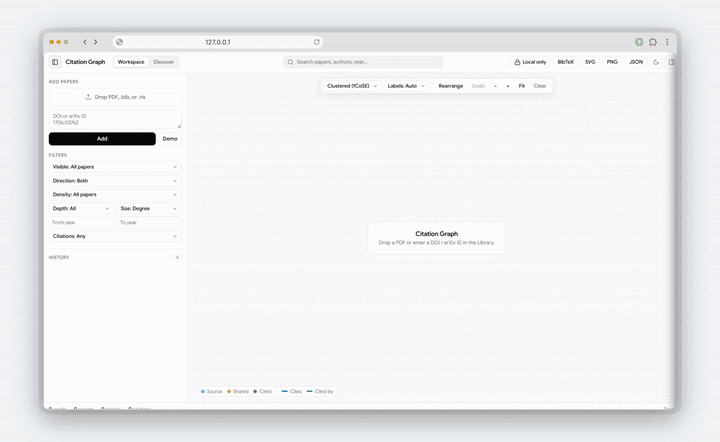

# OpenCite

A free, local interactive citation graph web app for exploring academic literature without paywalls, hairball graphs, or uploading unpublished PDFs to third-party servers.



## Features

- **Drop PDFs, `.bib`, or `.ris` Files:** Extracts references directly from single- and two-column PDFs (`pymupdf`) alongside **in-paper citation context** (the exact sentences where a reference is cited), or imports BibTeX (`.bib`) and RIS (`.ris`) libraries from Zotero, Mendeley, and EndNote.
- **DOI / arXiv / OpenAlex Lookup:** Paste one or more DOIs, arXiv IDs, or OpenAlex IDs to build a graph immediately using free open APIs (OpenAlex, Crossref, arXiv, Semantic Scholar abstract fallback).
- **Strict Local-Only (Offline) Mode:** Toggle **`Local only`** in the top bar to guarantee **zero outbound network requests**—ideal for unpublished manuscripts and confidential drafts.
- **Click-to-Focus & Expand:** Click any node to focus its citation neighborhood, inspect its abstract and citation contexts, and expand backward (**`← Older`**) or forward (**`→ Newer`**) citations on demand.
- **Anti-Hairball Controls:** Cap visible papers (**Top 20 / 40 / 60 / All**), filter by direction (**Both / Cites only / Cited by only**), relevance, depth, year range, minimum citations, or topic, and drag connected nodes together.
- **Multiple Layouts:** **Clustered** (`fCoSE`), **Timeline →** (sorted left-to-right by publication year), **Layered** (`ELK` citation flow), and **Ego-Network** (radial hops around the primary paper).
- **Retracted Paper Radar:** Automatically highlights retracted works (`is_retracted` via OpenAlex) with a red warning ring on the canvas and high-visibility badges in the Inspector and Discover views.
- **Discovery & Path Finding:** Rank **Bridge Papers** connecting multiple seeds, find shortest citation paths between any two papers, and auto-connect cross-citations (`Connect refs`).
- **Publication-Ready Exports:** Export the current graph to **BibTeX (`.bib`)**, **SVG**, **2× PNG**, or **JSON**.

## Quick Start

Requires **Python 3.11+** and **Node.js 20+** (or `uv`).

### macOS / Linux

```bash
git clone https://github.com/ameynarwadkar/OpenCite.git
cd OpenCite

# 1. Backend
python3 -m venv .venv
source .venv/bin/activate
pip install -e ".[dev]"

# 2. Frontend
cd frontend && npm install && npm run build && cd ..

# 3. Run
uvicorn backend.main:app --reload
```

### Windows (PowerShell)

```powershell
git clone https://github.com/ameynarwadkar/OpenCite.git
cd OpenCite

# 1. Backend
uv venv .venv
uv pip install --python .venv\Scripts\python.exe -e ".[dev]"

# 2. Frontend
cd frontend; npm install; npm run build; cd ..

# 3. Run
.venv\Scripts\uvicorn.exe backend.main:app --reload
```

Open **http://127.0.0.1:8000** in your browser.  
For frontend hot-reload during development, run `npm run dev` inside `frontend/` (proxies `/api` to `:8000`).

## Deploying with Docker (Free on Hugging Face Spaces / Render)

OpenCite includes a multi-stage `Dockerfile` (builds the TypeScript frontend and serves FastAPI on port `7860` or `$PORT`):

```bash
docker build -t opencite .
docker run -p 7860:7860 -e OPENALEX_MAILTO=you@university.edu opencite
```

Optional environment variables:
- `OPENALEX_MAILTO` — your email for OpenAlex/Crossref polite pool routing
- `OPENALEX_API_KEY` — optional OpenAlex API key
- `S2_API_KEY` — optional Semantic Scholar API key (used for fallback references/citations & abstracts)
- `RATE_LIMIT_REQUESTS` / `RATE_LIMIT_WINDOW_SECONDS` — per-IP `/api/*` rate limit (defaults to `60` req / `60s`; set `0` to disable)

## Tech Stack

- **Backend:** Python, FastAPI, PyMuPDF (`pymupdf`), `httpx`, Pydantic
- **Frontend:** TypeScript, Vite, Cytoscape.js (`cytoscape-fcose`, `cytoscape-elk`, `cytoscape-svg`)
- **Data Sources (optional when online):** OpenAlex, Crossref, arXiv, Semantic Scholar

## Running Tests

```bash
pytest -v
```
